<div align="center">

# Saryarqa Go

### Kazakhstan’s canyons and mountain lakes, booked in one chat

**A WhatsApp-first AI booking concierge that helps a small Astana tour company win travelers from India.**

Zerttex Hackathon 2026, Stage 1, Case 1: Technology Product. Team **РыбаЕж**


[Try the demo](#try-it-in-3-minutes) · [How it works](#how-tulpar-works) · [Business case](#business-case) · [Run locally](#run-locally) · [Deploy](#deploy)

[](https://vercel.com/new/clone?repository-url=https://github.com/nurbekkairbek2012-wq/zerttex)
[](https://app.netlify.com/start/deploy?repository=https://github.com/nurbekkairbek2012-wq/zerttex)

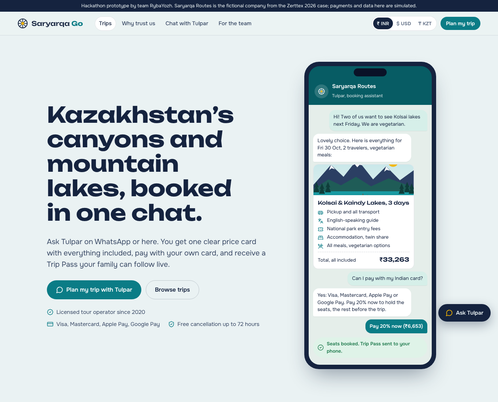

</div>

---

## The case in 30 seconds

**Saryarqa Routes** (a fictional company from the case) sells 2–7 day guided trips to Charyn Canyon, Kolsai Lakes, Turkestan and Burabay. In 2025 it served 3,400 travelers, but **96% came from Kazakhstan**. Foreign guests said:

> “It is unclear how to book.” · “I am not sure the company is trustworthy.” · “My foreign card does not work.” · “I do not know what is included.”

Goal: **30% of travelers from abroad within 24 months**, with a first-year budget of **20 million ₸**.

**Our answer:** pick one market, young travelers from India, and move the whole booking into the place they already talk to businesses: a chat.

| | |
|---|---|
| 🎯 **Market** | Travelers aged 22–40 from India: 146,000 visited Kazakhstan in 2024, **+87%** year on year |
| 💬 **Product** | **Tulpar**, an AI booking concierge on WhatsApp and the web, with a Clear-Price Trip Card, foreign-card checkout and a Trip Pass the family can follow live |
| ✅ **Proof** | Working prototype; demo engine answers **50/50** test questions and **16/20** unseen ones; Lighthouse desktop **100** in all four categories |
| 💰 **Money** | **19.9 M ₸** in year 1 · payback in **month 22** (month 34 if results are 30% worse) · **+17.5 M ₸** net over 3 years |
| 🌍 **Goal** | Foreign travelers reach **30.8%** of all travelers in month 24 |

---

## Contents

1. [Why India](#why-india)
2. [Four complaints, four features](#four-complaints-four-features)
3. [Try it in 3 minutes](#try-it-in-3-minutes)
4. [Screens](#screens)
5. [How Tulpar works](#how-tulpar-works)
6. [Architecture](#architecture)
7. [Payments and privacy](#payments-and-privacy)
8. [Business case](#business-case)
9. [12-week MVP plan](#12-week-mvp-plan)
10. [Quality](#quality)
11. [Run locally](#run-locally)
12. [Deploy](#deploy)
13. [Project structure](#project-structure)
14. [Team, AI use and honest notes](#team-ai-use-and-honest-notes)
15. [Sources](#sources)

---

## Why India

| Signal | Data |
|---|---|
| Size and growth | ~146,000 Indian tourists in 2024, +87% vs 2023 (Kazakh Tourism). India was 2nd in the Border Service’s top-5 source countries for Jan–Sep 2025 (~113,000, after China) |
| Headroom | Indians made **32.8 million** trips abroad in 2025 (+6.3%); Kazakhstan got only about 0.5% of them in 2024 |
| Access | 14 days visa-free; direct Delhi–Almaty flights of ~3.5 h; Kazakhstan has used UTC+5 since March 2024, just 30 minutes behind India |
| Momentum | Kazakh Tourism opened its first foreign office in India; Agoda saw +68% searches for Kazakhstan from India for winter 2025–26; Indian arrivals in Almaty grew 73.4% in Q1 2025 |
| Channel fit | 86% of online adults in India message a business every week (global 66%); 75% are more likely to buy from a business they can message |
| Testers next door | ~9,000 Indian students study in Kazakhstan, mostly medicine |
| Food matters | 39% of Indians are vegetarian and 81% limit meat, so “what is included” must say what is served |

China is larger (960,000+ visitors in 2025), but it needs a separate app and payment ecosystem. It is our **second market** (Alipay+ already works in Kazakhstan through Kaspi QR since August 2025).

---

## Four complaints, four features

| What guests said | What blocks a traveler from India | Saryarqa Go feature | Where in the code |
|---|---|---|---|
| “It is unclear how to book.” | Sales only in Instagram DMs, WhatsApp and phone calls, in office hours, in Russian | **Tulpar concierge**: turns “Kolsai for 2 next Friday, vegetarian” into a priced quote and a pay button, 24/7 | [`src/lib/tulpar.ts`](src/lib/tulpar.ts), [`/chat`](src/pages/ChatPage.tsx) |
| “I do not know what is included.” | Russian-only descriptions, no food information | **Clear-Price Trip Card**: date, guide, food, every inclusion and exclusion, one total in ₹ / $ / ₸; shareable to a WhatsApp group | [`src/components/Ticket.tsx`](src/components/Ticket.tsx) |
| “My foreign card does not work.” | Kaspi transfer needs a Kazakh account; Indian cards have international and online use off by default (RBI) | **Pay your way**: hosted bank page with 3-D Secure, Apple Pay, Google Pay; 20% deposit, full payment or **split with friends**; tip for Indian cards | [`src/pages/Book.tsx`](src/pages/Book.tsx) |
| “I am not sure the company is trustworthy.” | No reviews, licence, guide information or refund rules online | **Trust layer + Trip Pass**: verified company page, guide video intros, verified-trip reviews, refund promise, QR Trip Pass, **live trip view for family** | [`/trust`](src/pages/Trust.tsx), [`/pass`](src/pages/Pass.tsx), [`/live`](src/pages/Live.tsx) |
| *(company side)* | No numbers on foreign demand | **Team dashboard**: 30% goal meter, funnel, AI-resolved share, card success rate, handoff inbox | [`/operator`](src/pages/Operator.tsx) |

---

## Try it in 3 minutes

1. **Home** — watch the chat in the phone book a trip in about 6 seconds.
2. **Chat** — open **Chat with Tulpar** and type: `Kolsai lakes for 2 next Friday, veg`. You get a Clear-Price Trip Card.
3. Ask anything: `Do I need a visa?`, `my card got declined`, `what if it rains?`, `talk to a human`.
4. **Pay 20% now** → fill in any name, email and an Indian phone number → **Pay** → bank code **`123456`**.
5. **Trip Pass** — QR code, payment status, calendar file, WhatsApp share → **Open live trip view** and move the slider.
6. **For the team** — your booking appears highlighted in the dashboard.
7. **About the project** — one page with the whole case for the jury.

Switch **₹ / $ / ₸** in the header at any time. Payments are simulated: never enter a real card.

---

## Screens

| Chat with Tulpar | Checkout | Trip Pass |
|---|---|---|
| 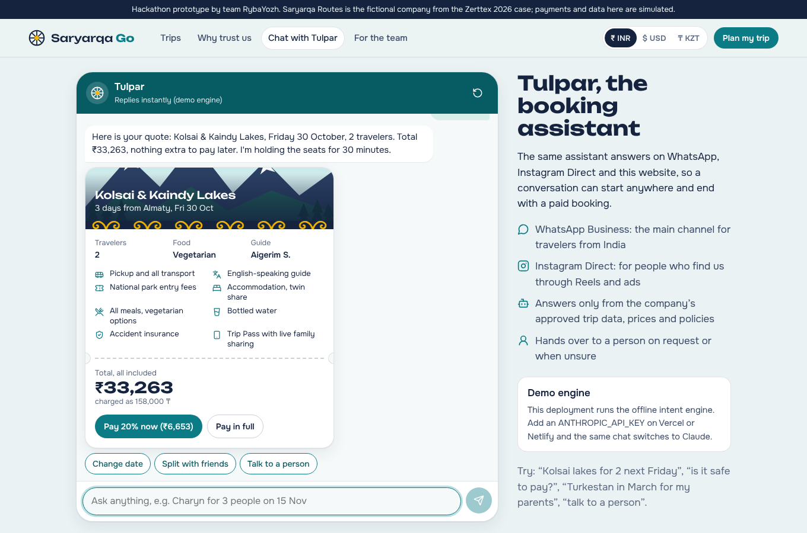 | 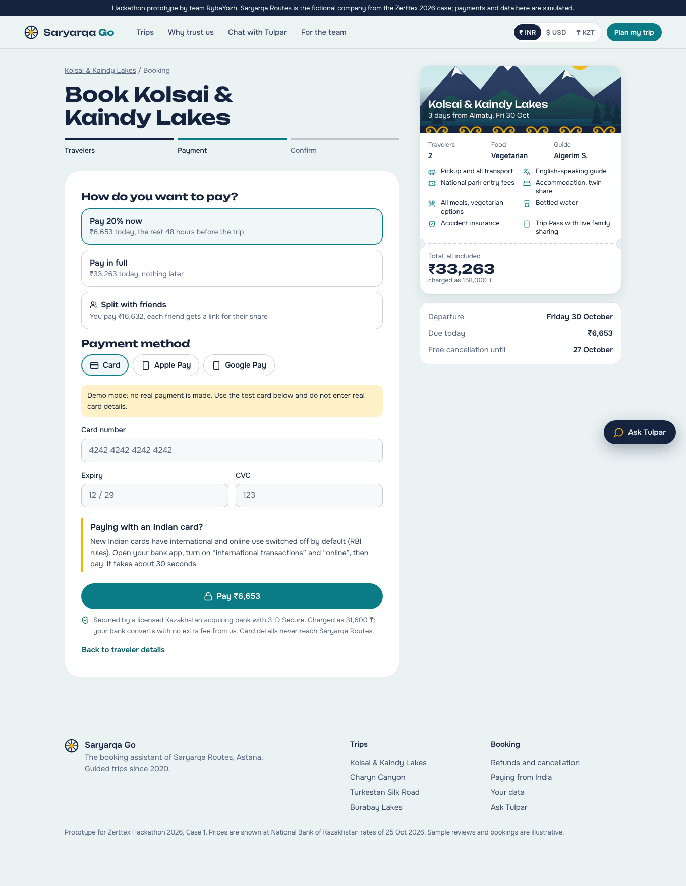 | 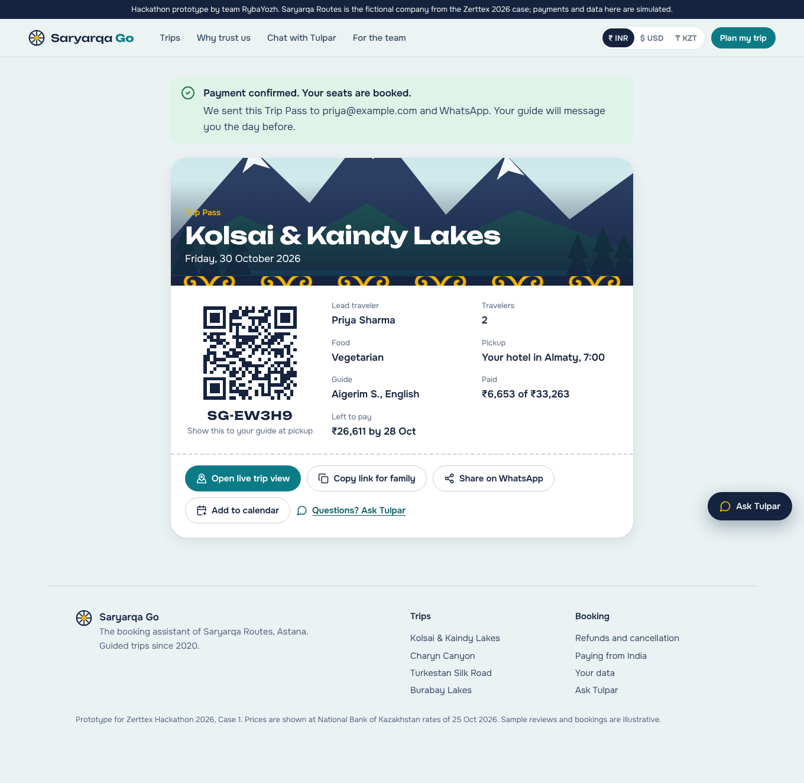 |

| Trip page | Live view for family | Team dashboard |
|---|---|---|
| 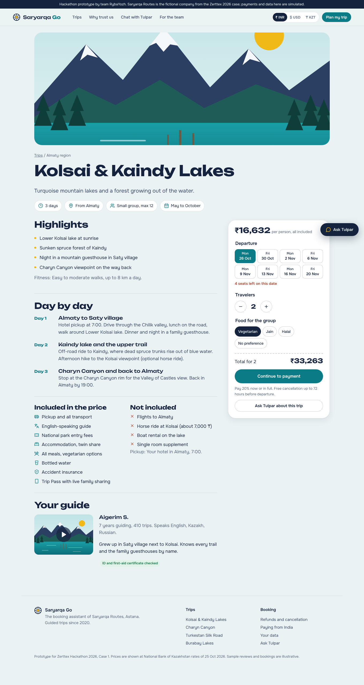 | 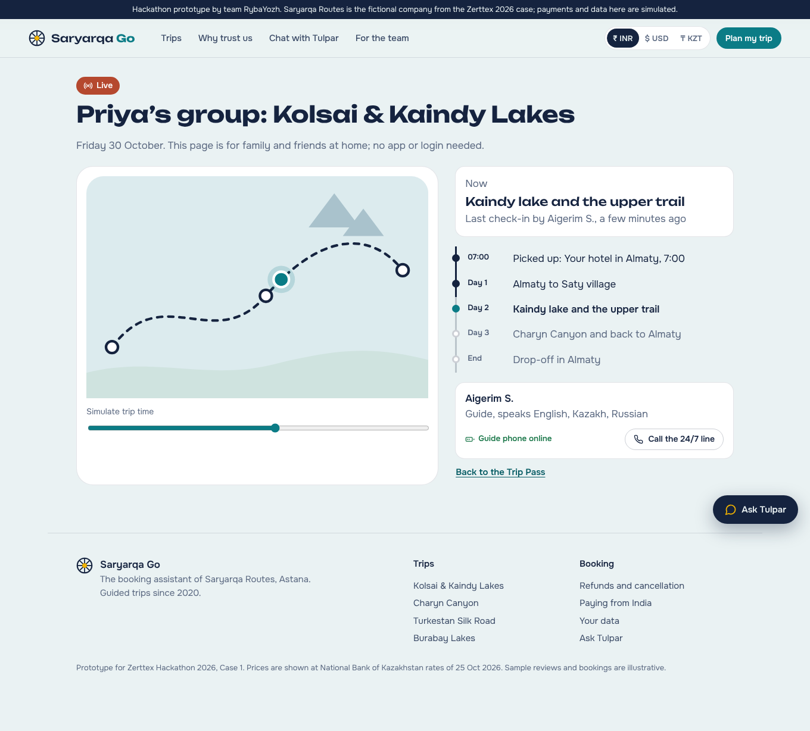 | 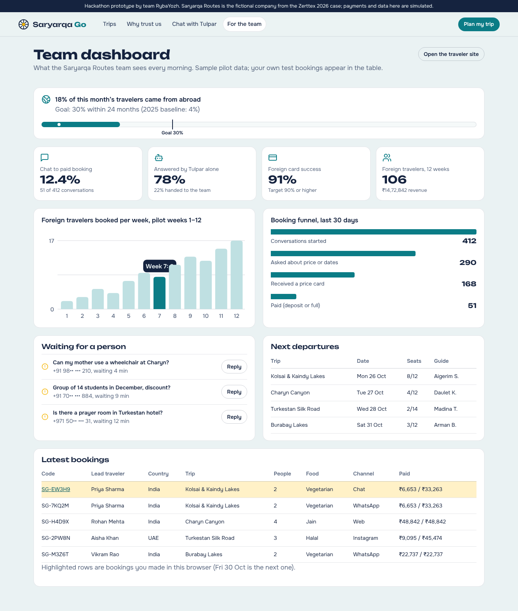 |

<details>
<summary>Mobile flow and more screens</summary>

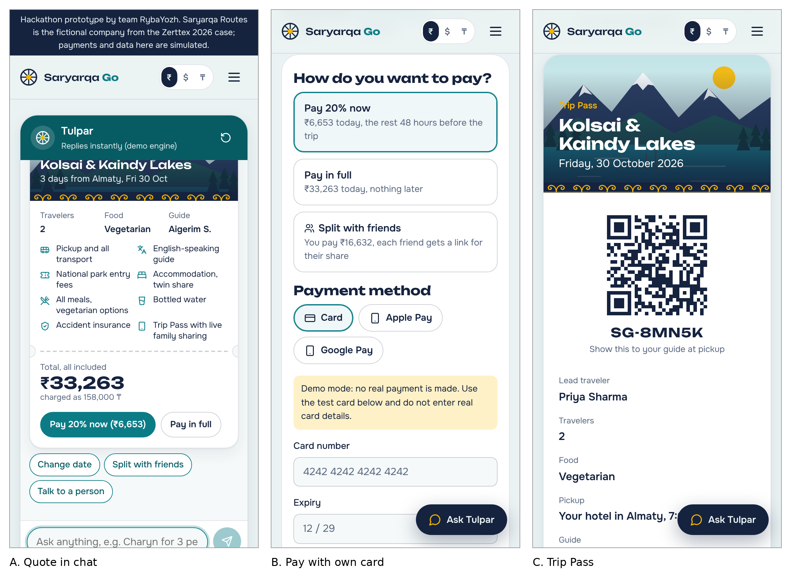
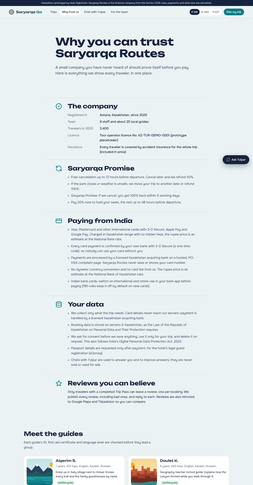
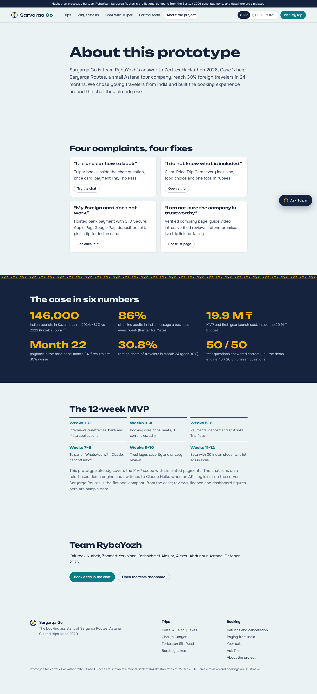

</details>

---

## How Tulpar works

Tulpar has **two engines behind one interface** ([`src/lib/ai.ts`](src/lib/ai.ts)):

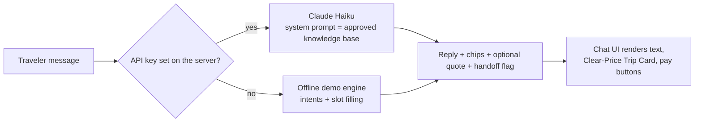

**Demo engine** ([`src/lib/tulpar.ts`](src/lib/tulpar.ts)) — runs in the browser, so the demo works anywhere, even offline:

- **Intents** (visa, price, inclusions, food, payment, UPI, refunds, weather, trust, guides, stay, group size, season, difficulty, packing, split, handoff…) answered **only** from [`shared/knowledge.json`](shared/knowledge.json).
- **Slot filling** for booking: trip, date, travelers, food. Understands “next Friday”, “15 Nov”, “14/11”, “this weekend”, “family of 5”, “just me”, “Jain”.
- Snaps a wanted date to the trip’s real departure days and says so.
- Topics outside the knowledge base (eSIM, ATMs…) are **never guessed**: they go to a person.

**LLM mode** ([`shared/tulpar-core.mjs`](shared/tulpar-core.mjs)) — a serverless function sends the last 12 messages to **Claude Haiku** with the knowledge base as the only source of facts and asks for strict JSON: `reply`, `chips`, `quote`, `handoff`. Prices and seats are re-checked against the knowledge base in the browser before a quote is shown. One ten-message conversation costs about 2–3 ₸.

**Measured:** 50 typical questions, written by the team → **48/50 on the first run, 50/50** after fixing two gaps. 20 new questions that were never used for tuning → **16/20 (80%)**. That gap is exactly why the MVP uses the LLM mode with a 90% target.

---

## Architecture

Production target for the 12-week MVP:

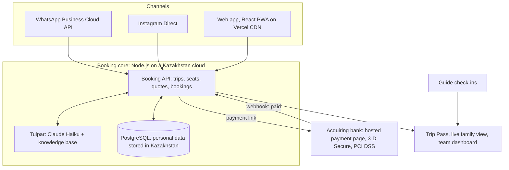

| Layer | MVP choice | Why |
|---|---|---|
| Web app | React 18 + TypeScript + Vite, PWA | Fast on mobile, installable, one codebase |
| Chat channels | WhatsApp Business Cloud API, Instagram messaging | Where Indian travelers already talk to businesses |
| AI | Claude Haiku 5.5 ($0.10 / $0.50 per million input / output tokens) | Cheap, fast, follows a grounded system prompt |
| Booking API | Node.js + PostgreSQL on a Kazakhstan cloud | Personal data must be stored in Kazakhstan |
| Payments | Hosted page of a Kazakhstan acquiring bank | Foreign cards, 3-D Secure, no card data on our servers |
| Hosting | Vercel or Netlify (static + one function) | Free tier for the pilot, global CDN |

---

## Payments and privacy

- **Card data never reaches our servers:** the bank’s PCI DSS hosted page and 3-D Secure handle it.
- **No dynamic currency conversion:** prices are charged in tenge; the rupee price is an estimate at the National Bank rate.
- **Indian cards:** the checkout tells travelers to switch on international and online use first (RBI default-off rule since March 2020; extra authentication for cross-border online payments from 1 October 2026).
- **Data in Kazakhstan:** Article 12(2) of the Law on Personal Data and Their Protection; consent first, minimal data, deletion on request, following the notice-and-consent standard of India’s DPDP Act 2023 and Rules 2025.
- **Passport details only after payment**, for the hotel’s legal guest registration (eQonaq).

---

## Business case

All amounts in tenge (₸). 1 USD = 451.05 ₸, 1 INR = 4.75 ₸ (National Bank of Kazakhstan, 25 Oct 2026).

| Year 1 cost | ₸ |
|---|---|
| Development: MVP team for 12 weeks + support for 9 months + content + legal and payment setup | 11,600,000 |
| Launch in India: Click-to-WhatsApp ads, travel creators, student ambassadors | 4,950,000 |
| Running: hosting in Kazakhstan, Claude API, WhatsApp, software | 1,755,000 |
| Contingency | 1,600,000 |
| **Total (budget 20,000,000)** | **19,905,000** |

| Key assumption | Value |
|---|---|
| Revenue per foreign traveler | 66,000 ₸ (1.5× the company’s 44,000 ₸ average; all-inclusive international package) |
| Contribution per extra foreign traveler | 16,500 ₸ (30% trip margin − 3.5% card fee − 1.5% referrals) |
| Running cost from year 2 | 10.42 M ₸ / year |
| Break-even | ~450 extra foreign travelers a year; plan for year 2 is 1,260 |

| Scenario | Payback | Net after 3 years |
|---|---|---|
| Base plan | month 22 | +17.5 M ₸ |
| 30% fewer travelers | month 34 | +1.4 M ₸ |
| 30% fewer travelers, ads cut 30% from month 13 | month 31 | +4.5 M ₸ |
| Price −20% | month 28 | +7.4 M ₸ |
| Margin 25% instead of 30% | month 28 | +6.8 M ₸ |

**Impact (year 2, team estimates):** ~125 extra group departures, ~380 paid guide-days, ~2,500 nights in village guesthouses and yurt camps, ~400 verified English reviews of Kazakhstan a year.

---

## 12-week MVP plan

| Weeks | Work | Result |
|---|---|---|
| 1–2 | Interviews with Indian students and guides, journey map, wireframes; bank and Meta applications | Clickable design, partners applied |
| 3–4 | Booking core: trips, departures, seats, 3 currencies, admin | Catalogue on a test server |
| 5–6 | Payments: hosted page, 3-D Secure, deposit and split links, Trip Pass | First real payment from an Indian card |
| 7–8 | Tulpar: knowledge base, Claude, WhatsApp Cloud API, handoff inbox | 90% correct on 100 real questions |
| 9 | Trust layer: company page, guide videos, verified reviews, live view | All trust features live |
| 10 | Testing, security and privacy review, analytics | Release candidate |
| 11 | Closed beta with 30 Indian students and 5 guides | Beta report |
| 12 | Pilot ads in Delhi, Mumbai, Bengaluru; go/no-go | First paid bookings from India |

**Success metrics:** booking in under 5 minutes · SUS ≥ 75 · ≥ 90% correct AI answers · ≥ 90% foreign card success · ≥ 10% chat-to-paid · ≥ 20 paid bookings from India in the first 4 weeks of the pilot.

**After the MVP:** Hindi, then China (Chinese language pack + Alipay+), Gulf and Korea; white-label for other small Kazakh operators.

---

## Quality

| Check | Result |
|---|---|
| Tulpar test set, 50 questions ([`tulpar.test.ts`](src/lib/tulpar.test.ts)) | 48/50 on first run → **50/50** |
| Hold-out benchmark, 20 unseen questions ([`tulpar.holdout.test.ts`](src/lib/tulpar.holdout.test.ts)) | **16/20 (80%)** |
| Lighthouse, desktop | Performance **100** · Accessibility **100** · Best practices **100** · SEO **100** |
| Lighthouse, mobile (simulated slow 4G) | Performance **83** · Accessibility **100** · Best practices **100** · SEO **100** |
| TypeScript | `strict`, no errors |
| Responsive | Every page works at 390 px width, no horizontal scroll |
| Accessibility | Keyboard focus, labels, `prefers-reduced-motion`, dark mode |
| PWA | Manifest, icons, service worker |

---

## Run locally

Requires Node.js 18+.

```bash
npm install
npm run dev           # http://localhost:5173
npm test              # 50 test questions + hold-out benchmark
npm run build         # production build in dist/
npm run preview       # serve the build
npm run build:single  # the whole app as one HTML file in dist-single/ (works offline)
```

---

## Deploy

**Vercel:** click **Deploy with Vercel** above, or import the repo at vercel.com/new. `vercel.json` sets the build and SPA routing.
**Netlify:** click **Deploy to Netlify**; `netlify.toml` sets the build, SPA fallback and the `/api/*` function route.

### Switch Tulpar to Claude (optional)

Without a key, Tulpar uses the offline demo engine, so the demo always works. To turn on the LLM mode, add environment variables in the Vercel or Netlify project settings:

```
ANTHROPIC_API_KEY=sk-ant-...
TULPAR_MODEL=claude-haiku-5-5   # optional
```

---

## Project structure

```
├── api/chat.mjs                  Vercel serverless function (POST /api/chat)
├── netlify/functions/chat.mjs    Same function for Netlify
├── shared/
│   ├── knowledge.json            Trips, prices, policies, guides: the single source of truth
│   └── tulpar-core.mjs           Grounded prompt + Claude call, strict JSON output
├── src/
│   ├── lib/
│   │   ├── tulpar.ts             Offline intent + slot-filling engine
│   │   ├── tulpar.test.ts        50-question test set
│   │   ├── tulpar.holdout.test.ts 20-question hold-out benchmark
│   │   ├── ai.ts                 Chat transport: API first, offline fallback
│   │   ├── chat.tsx, store.tsx   Shared chat and booking state
│   │   └── kb.ts, money.ts       Typed knowledge base, currencies
│   ├── components/               Ticket (Clear-Price card), Chat, PhoneDemo, Art, Layout, QR
│   └── pages/                    Home, Trip, Book, Pass, Live, Trust, ChatPage, Operator, About
├── public/                       PWA manifest, icons, service worker, robots.txt
├── docs/                         Screenshots, diagrams, interview questionnaire
├── vercel.json, netlify.toml     Deploy configs
└── vite.config.ts                Normal and single-file builds
```

---

## Team, AI use and honest notes

**Team РыбаЕж** (Astana): Kaiyrbek Nurbek, Zhomart Yerkainar, Kozhakhmet Aldiyar, Alexey Abdunnur.

- **AI use:** most of the code in this repository was written with an AI coding assistant (Claude by Anthropic); the team reviewed, tested and deployed it. See the AI Declaration in our report.
- Saryarqa Routes is the **fictional** company from the case. Payments, reviews, the licence number, dashboard numbers and bookings in the app are **simulated sample data** and are labelled as such.
- Illustrations are original vector art made for this project (including the Kazakh *qoshqar müiz* ornament and the *shanyraq* logo). Fonts: Unbounded and Onest (SIL Open Font License). Icons: Lucide (ISC).

---

## Sources

Market and payment figures in this README come from the sources below (all opened on 25 Oct 2026). Full references are in the report.

- Kazakh Tourism via [Bizmedia.kz](https://bizmedia.kz/2025-12-02-na-30-vyrastet-chislo-turistov-iz-indii-v-kazahstan-po-ozhidaniyam-kazakh-tourism/) and [Kazpravda](https://kazpravda.kz/n/v-kazahstan-vse-chashche-edut-otdyhat-iz-indii/): Indian tourists 2024
- [Tengrinews](https://tengrinews.kz/my-country/kitay-indiya-ne-tolko-nazvan-top-stran-otkuda-kazahstan-589095/): Border Service top-5 countries, Jan–Sep 2025
- [Ministry of Tourism of India, Annual Tourism Snapshot 2025](https://tourism.gov.in/sites/default/files/2026-06/Annual%20Tourism%20Snapshot%202025.pdf): Indian outbound trips
- [Outlook Traveller](https://www.outlooktraveller.com/whats-new/kazakhstan-opens-its-first-international-tourism-office-in-india): visa-free stay, flights, Kazakh Tourism office in India
- [The Peninsula / Kazinform](https://s.thepeninsula.qa/article/11/03/2025/kazakhstan-gains-popularity-among-indian-tourists-students): Indian students in Kazakhstan
- [Bizmedia.kz](https://bizmedia.kz/2025-06-20-almaty-v-trende-indusy-kitajczy-i-turki-edut-smotret-gorod-vse-chashhe/): Indian arrivals in Almaty, Q1 2025
- [Kantar for Meta, via Social Samosa](https://www.socialsamosa.com/2022/10/business-messaging-usage-report-kantar-meta): business messaging in India
- [Pew Research Center](https://www.pewresearch.org/short-reads/2021/07/08/eight-in-ten-indians-limit-meat-in-their-diets-and-four-in-ten-consider-themselves-vegetarian/): vegetarianism in India
- [Razorpay](https://razorpay.com/blog/international-card-payment-failures/): international card failures and RBI rules
- [Kazakhstan Today](https://www.kt.kz/eng/government/nearly_16_million_foreign_visitors_traveled_to_kazakhstan_1377999157.html): 2025 visitors, China growth
- [Intelligent CIO](https://www.intelligentcio.com/apac/2025/08/14/alipay-and-kaspi-kz-enable-international-payment-acceptance-in-kazakhstan/): Alipay+ via Kaspi QR
- [timeanddate.com](https://www.timeanddate.com/news/time/kazakhstan-single-time-zone.html): Kazakhstan single time zone
- [Anthropic pricing](https://platform.claude.com/docs/en/about-claude/pricing): Claude Haiku 5.5 price
- [National Bank of Kazakhstan](https://nationalbank.kz/en/exchangerates/ezhednevnye-oficialnye-rynochnye-kursy-valyut): exchange rates

---

<div align="center">

MIT License · Made in Astana for Zerttex Hackathon 2026

</div>
